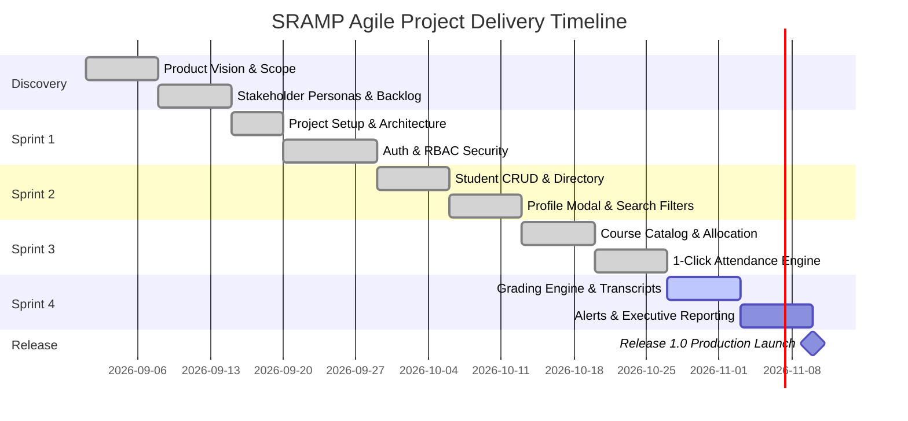

# Project Timeline and Release Roadmap
## Student Record and Academic Management Platform (SRAMP)

---

### 1. Project Timeline Overview
The project spans an 8-week intensive development lifecycle divided into four 2-week Sprints, preceded by Unit 1 Product Discovery and followed by institutional deployment.



---

### 2. Multi-Release Roadmap

```
+-----------------------------------------------------------------------------------------+
|                                    PRODUCT ROADMAP                                      |
+-----------------------------------------------------------------------------------------+
|  RELEASE 1.0 (MVP)               |  RELEASE 1.1 (Enhancement)    |  RELEASE 2.0 (Expansion)   |
|  Current Delivery                |  Q1 Next Year                 |  Q2 Next Year              |
|----------------------------------+-------------------------------+----------------------------|
| • Secure Multi-Role Login & RBAC | • Biometric Attendance Sync   | • Mobile App (iOS/Android) |
| • Student Lifecycle Directory    | • Batch CSV Grade Import      | • Fee & Scholarship Ledger |
| • Dynamic Course Catalog         | • Automated Parent SMS Alerts | • AI Academic Early Warning|
| • 1-Click Classroom Attendance   | • Multi-Semester CGPA Graphs  | • University ERP / LMS API |
| • Automated Letter Grading & GPA | • Enhanced Audit Log Export   | • Multi-Campus Tenancy     |
| • Attendance Alerts (<75%)       | • Faculty Timetable Drag-Drop | • RFID Turnstile Gate Sync |
| • Printable Student Report Cards | • Dark/Light Mode Preference  | • Blockchain Credentials   |
+-----------------------------------------------------------------------------------------+
```

---

### 3. Sprint Delivery Milestone Summary

| Milestone | Target Sprint | Primary Feature Increment | Business Impact |
|---|---|---|---|
| **M1: Secure Core** | Sprint 1 | Express server, Auth guards, RBAC personas (Admin/Faculty/Student), UI foundation. | High security foundation; stakeholder demo capability. |
| **M2: Student Directory** | Sprint 2 | Student registration, real-time search, profile drawer, update/delete workflows. | 100% elimination of paper student files. |
| **M3: Attendance Hub** | Sprint 3 | Course creation, student enrollment, 1-click attendance marking, session logs. | 85% time reduction in classroom attendance logging. |
| **M4: Academic Performance** | Sprint 4 | Marks entry, automated letter grades, GPA calculation, printable report cards. | Zero human calculation error in academic transcripts. |
| **M5: Operational Insights** | Sprint 4 | Notification bell, attendance alerts (<75%), analytics charts, CSV export. | Real-time compliance and executive institutional visibility. |
